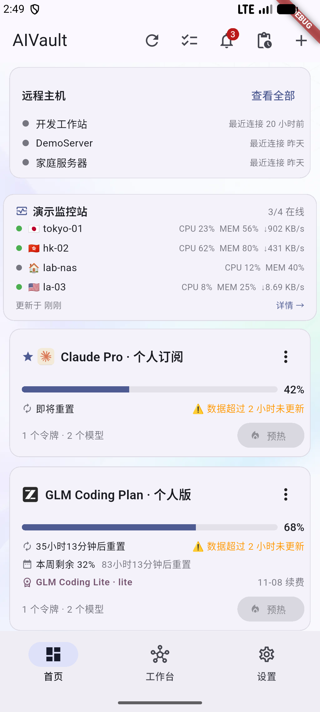
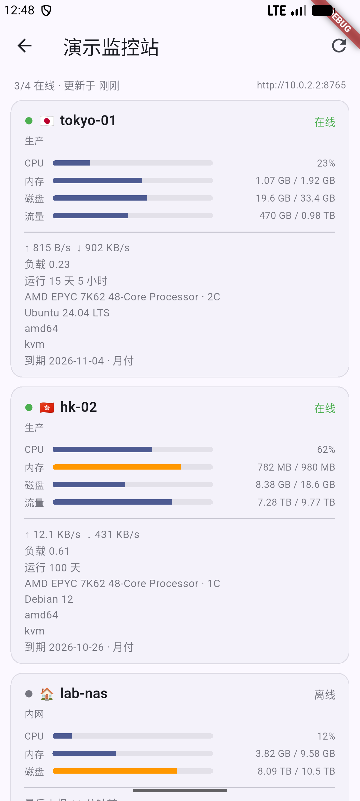
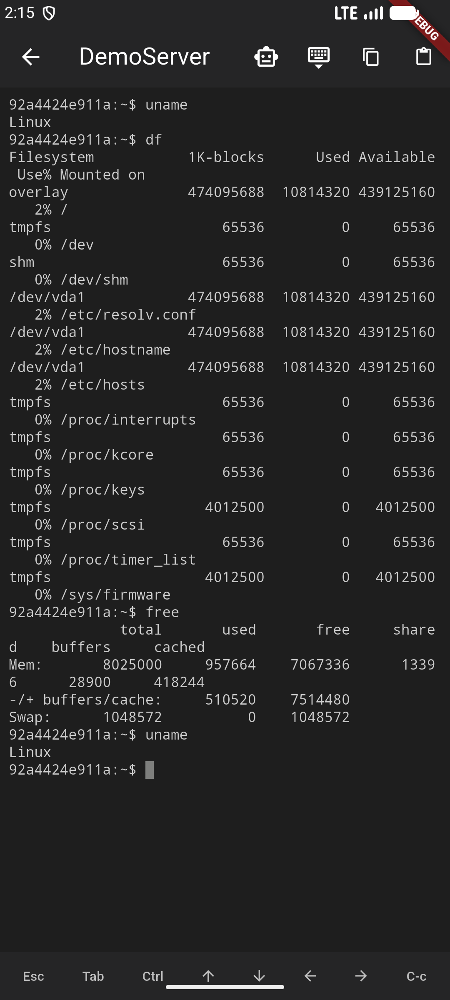

# AIVault

**AI 订阅看板 · 探针监控 · SSH 远程开发 · 随身 AI 工作台** —— 一个本地优先的 Android App：管理所有 AI 订阅与中转站的额度、余额、重置时间，批量签到 / 预热；接入 Komari 探针在手机上看服务器负载；内置 AI 聊天与画图；通过 SSH + tmux 观战和接管电脑里的 Agent（Claude Code / Codex / OpenCode）。

[项目主页](https://ahao430.github.io/AIVault/) · [下载最新版](https://github.com/ahao430/AIVault/releases/latest) · [更新日志](./CHANGELOG.md) · [设计基线](./Plan.md)

| 首页看板 | 探针详情 | SSH 终端 |
| --- | --- | --- |
|  |  |  |

技术方案：**Flutter + SQLite（drift）+ 本地优先 + WebDAV 可选同步**。
目前只分发 Android 安装包；iOS / macOS / Windows 由 Flutter 支持，但**未经编译适配
测试**，欢迎 fork 仓库自行构建验证。

> 数据全部存在本机，API Key 只进系统安全存储（Keychain / Keystore）；同步是可选的，且密钥是否随同步单独控制。

## 功能总览

### 订阅看板
- 供应商 / Token / 模型三级数据模型（同一供应商的不同账户视为不同实例）
- 首页卡片：额度进度 + 重置倒计时、余额、本月已用，官方供应商带品牌图标（Claude / OpenAI / 智谱 / DeepSeek / NewAPI 等）；置顶、隐藏，排序在「订阅管理」页用上下箭头调整（首页不做拖拽，避免与滚动手势冲突）
- **工作台「订阅管理」**：全量供应商列表，每个供应商单独控制「首页显示」与「**桌面小组件显示**」两个开关（数据保留，只影响展示）
- **首页板块顺序**：设置 → 首页板块顺序，用上下箭头调整 远程主机 / 探针监控 / 订阅看板 的排列（默认探针在订阅上方），改动即时生效
- 适配器：NewAPI / Sub2API / 智谱 Coding Plan（双格式，**套餐名 + 续费日期 + 周/5h 双窗口**）/ Kimi Code（双窗口 + 档位）/ OpenCode Go（三窗口）/ DeepSeek（双格式）/ Moonshot 按量 / OpenAI 兼容 / Claude 官方订阅
- 批量签到 / 批量预热；预热规则：**只有额度达到 100% 才执行**，状态未知一律跳过
- 查询失败保留上一次成功快照，不显示为 0
- 任务中心：批量操作后台执行，进度 / 取消 / 重试失败项 / 结果明细
- 额度历史（sparkline 走势 + 明细）、模型测试历史（9 类失败原因分类）
- **桌面小组件（Android）**：置顶前 4 个供应商的额度 / 余额 + 倒计时；刷新按钮后台拉取不打开 App；**自动刷新**（30 分钟 WorkManager 周期任务 + 开机补刷 + 系统周期触发，15 分钟节流，任务跨重启持久）；另有 **HyperOS（小米澎湃 OS）专用变体**——系统圆角裁切适配、加大字号
  > 说明：Android 8.0 起「每次解锁」「切到小组件所在桌面页」都没有公开 API（解锁广播被隐式广播限制拦下），自动刷新以上述三条链路兜底，数据至多落后约 30 分钟。
- 通知中心：额度恢复可预热 / 今日可签到 / 数据过期三类事件 + 系统本地通知转发
- App 锁：PIN + 生物识别（Touch ID / Face ID / 指纹）

### AI 工作台
- AI 聊天：会话管理、OpenAI 兼容流式输出、Markdown / 代码高亮、推理模型 reasoning 折叠、重新生成、导出长图
- AI 画图：单次生成、参考图（edits multipart）、历史网格、图片详情

### 探针监控（Komari）
- 工作台「探针管理」添加 Komari 面板：公开站点填地址即用，私有站点配管理员 API Key（Bearer，只存本机安全存储）
- 首页探针区：每个站点一张卡，**在线比 + 节点行（区域旗标 / CPU / 内存 / 实时网速）**；每个站点可单独开关「首页显示」
- 节点详情页：CPU / 内存 / 磁盘 / 流量限额进度条（超 75% 变橙、90% 变红）、实时网速、负载、进程与连接数、运行时长、系统 / 内核 / 虚拟化、套餐到期与计费周期；页面停留期间每 15 秒自动刷新
- 数据源：`GET /api/nodes` + `GET /api/recent/{uuid}`（实测 komari-monitor/komari），节点数据本地缓存，离线也能看上一次状态
- 面板类型字段已预留（`kind`），后续可按同一套抽象接入哪吒等其他面板

### 书签管理
- 工作台「书签管理」：收藏常用网址（控制台 / 面板 / 文档），长按列表拖拽排序
- 点击在**应用内 WebView** 打开：网页内后退（系统返回键优先退网页历史）、刷新、复制当前网址，标题自动跟随页面
- 网址自动补全 `https://`；新增 / 编辑为轻量弹窗表单

### SSH 远程开发
- SSH 主机管理（dartssh2，Key / 密码认证，凭证只存安全存储），首次连接 host key TOFU 校验（指纹变化拒绝连接），Tailscale 标记提示
- 完整 xterm 终端（pty + xterm-256color，ANSI / 全屏 TUI / tmux attach，桌面端快捷键 / 右键复制粘贴）+ 移动端快捷键条
- tmux 会话列表（窗口数 / attached / Agent 识别：Claude Code / Codex / OpenCode / Pi），App 内新建 / 恢复会话
- **终端 AI 助手**：当前屏幕作上下文提问；命令一键「执行」后自动读回终端新增输出继续分析；**自动续跑**模式会把「执行 → 读结果 → 分析 → 下一步」循环跑到任务完成（上限 8 轮，随时可停；破坏性命令拒执行）
- 首页远程状态区（在线主机 + 最近连接）、首次使用引导

### 数据与安全
- JSON 导入导出（默认脱敏，按 id 合并）；CC Switch / Magpie 导出链接
- WebDAV 同步：推送 / 拉取 / 冲突检测，**内置坚果云 / InfiniCloud 预设**；父目录不存在（坚果云返回 409）时自动逐级建目录重试；密钥是否随同步单独控制
- 应用内更新：按 ABI 拆包（arm64 / armv7 / x86_64），固定签名覆盖升级不丢数据，GitHub 直连不通时自动走镜像

## 目录结构

```
lib/
├── main.dart / app.dart          # 入口 + 底部三 Tab（首页 / 工作台 / 设置）
├── adapters/                     # ProviderAdapter 适配器（核心抽象）
├── core/                         # 安全存储、主题、格式化、品牌图标映射
├── data/
│   ├── db/                       # drift 表定义 + 数据库（SQLite）
│   └── repositories/             # 仓库层（聚合视图模型）
├── services/                     # 刷新 / 签到 / 预热 / 任务中心 / WebDAV /
│                                 #   小组件同步 / Komari 客户端 / 更新检查 / SSH / tmux
├── state/                        # Riverpod providers
└── ui/
    ├── home/                     # 订阅看板（卡片 + 拖拽 + 远程状态区 + 探针区）
    ├── provider/                 # 供应商详情 / 编辑 / 订阅管理 / 额度历史
    ├── monitor/                  # 探针管理（站点列表 / 编辑 / 节点详情）
    ├── bookmarks/                # 书签管理（列表 + 应用内 WebView）
    ├── chat/  image/             # AI 聊天 / AI 画图
    ├── ssh/                      # 主机管理 / 终端 / tmux / 终端 AI 助手
    ├── workbench/  tasks/        # 工作台入口 / 任务中心
    └── settings/  lock/  ...     # 设置 / WebDAV / App 锁 / 通知
android/…/AIVaultWidgetProvider.kt  # 桌面小组件（含 HyperOS 变体）+ 自动刷新调度
```

## 开发

```bash
flutter pub get
dart run build_runner build --delete-conflicting-outputs --force-jit   # 生成 drift 代码
flutter test                                                           # 单元测试
flutter run                                                            # 运行到连接的设备 / 模拟器
flutter build apk --debug                                              # Android 调试包
```

> 注：当前工具链（Dart 3.10）运行 build_runner 需带 `--force-jit`。

### 其他平台（iOS / macOS / Windows，未经适配测试）

Flutter 本身跨平台，但本项目目前只在 Android 上做过编译、安装与功能测试；
其他平台未验证，欢迎 fork 仓库自行构建测试。macOS 注意：`keychain-access-groups`
（flutter_secure_storage 的 Keychain 共享）需要有效的开发团队签名才能生效 ——
无签名团队时该 entitlement 会导致 App 以 `Code Signature Invalid` 被杀；当前
debug 构建未包含它，正式分发前请在 Xcode 中开启 Keychain Sharing（配合签名
团队）后再构建。

## Android 发版

按 ABI 拆分安装包（arm64-v8a 主流新机 / armeabi-v7a 老设备 / x86_64 模拟器，不做 universal 大包），
固定 keystore 签名（GitHub Secrets 注入，覆盖安装升级不丢数据），
应用内「设置 → 检查更新」自动检测 GitHub Release 并安装。

```bash
git tag v0.4.18+19 && git push origin v0.4.18+19   # 触发发版流水线
```

完整流程（密钥生成、Secrets 配置、故障排查）见 [RELEASING.md](./RELEASING.md)。

## 迭代路线

- ✅ **P0-P3 已完成**：订阅看板全量、任务中心、通知、WebDAV、桌面小组件（含 HyperOS + 自动刷新 + 组件展示开关）、App 锁、AI 聊天 / 画图、SSH 远程开发 + 终端 AI 助手、Komari 探针监控、首页板块顺序、书签管理
- **P4 规划**：SFTP 文件管理、端口转发、更多官方适配器（MiniMax 等）、更多探针面板（哪吒等，`kind` 字段已预留）、iOS 小组件（WidgetKit）
